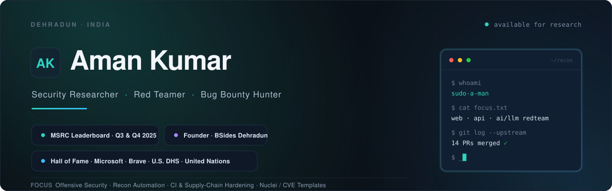

<div align="center">



<br/>

[](https://github.com/theleetsec)
[](https://bsidesdehradun.com)
[](https://linkedin.com/in/sudoaman)
[](https://x.com/sudoaman)

</div>

<br/>

## whoami

Security researcher from Dehradun, about four years deep in web application security, network penetration testing, and red teaming, now spending a lot of that time on AI and LLM red teaming. I like the bugs scanners walk past: logic flaws, broken boundaries, the request that routes somewhere it should not. Most of my public work is reconnaissance tooling and open-source security fixes.

I founded [BSides Dehradun](https://bsidesdehradun.com) and run it every year, and I build [LeetSec](https://github.com/theleetsec) alongside it.

<br/>

## Recognition

- **Microsoft Security Response Center (MSRC)** · Researcher Leaderboard, Q3 and Q4 2025, for critical Azure and O365 findings
- **Halls of Fame** · Microsoft, Brave, U.S. Department of Homeland Security, United Nations
- **Top 15 Security Researcher in India, 2021** · NCIIPC (NTRO)
- **50+ vulnerabilities** responsibly disclosed across public programs
- **Certifications** · CEH (Practical) v12 · Certified Network Security Practitioner · Information Security Certified Professional

<br/>

## Open source

Fourteen pull requests merged into upstream projects I do not own, with more in review. A few:

| Project | Contribution | Status |
| :--- | :--- | :---: |
| [projectdiscovery/nuclei-templates](https://github.com/projectdiscovery/nuclei-templates/pull/17446) | Detection template for CVE-2026-90817, a critical unauthenticated REDCap RCE | Merged |
| [limitlessprojects/Go-Hybrid](https://github.com/limitlessprojects/Go-Hybrid/pulls?q=is%3Apr+author%3Asudo-a-man) | 5 fixes to the compiler's soundness gates and differential test harness | Merged |
| [Sottara-Labs/sottara](https://github.com/Sottara-Labs/sottara/pulls?q=is%3Apr+author%3Asudo-a-man) | 8 fixes across CI release gating, rate-limit boundaries, and identity resolution | Merged |
| [trufflesecurity/trufflehog](https://github.com/trufflesecurity/trufflehog/pulls?q=is%3Apr+author%3Asudo-a-man) | RunPod and Fireworks AI API key detectors | In review |

<br/>

## Projects

**[LeetEnum](https://github.com/theleetsec/LeetSec-Tools)** · a reconnaissance pipeline for authorised security assessments. Twelve-plus passive sources queried in parallel, tiered DNS brute force and permutations, resumable checkpoints, and JSONL and Markdown reports. Ships through Homebrew and Docker with CI-tested releases.

```sh
brew install theleetsec/tap/leetenum
leetenum example.com --subs
```

<br/>

## BSides Dehradun

Founder and lead organiser of Uttarakhand's security conference. Two days of talks, workshops, villages, and a CTF, run by volunteers.

- **0x01 (2024)** · 187 attendees
- **0x02 (Jan 2026, UPES)** · 255 attendees, international speakers
- **0x03 (3 to 4 April 2027)** · targeting 400+, [call for papers open](https://bsidesdehradun.com)

<br/>

## GitHub

<div align="center">


</div>

<br/>

<div align="center">
<sub>Dehradun, India · <a href="mailto:sudoaman0x@gmail.com">sudoaman0x@gmail.com</a></sub>
</div>
